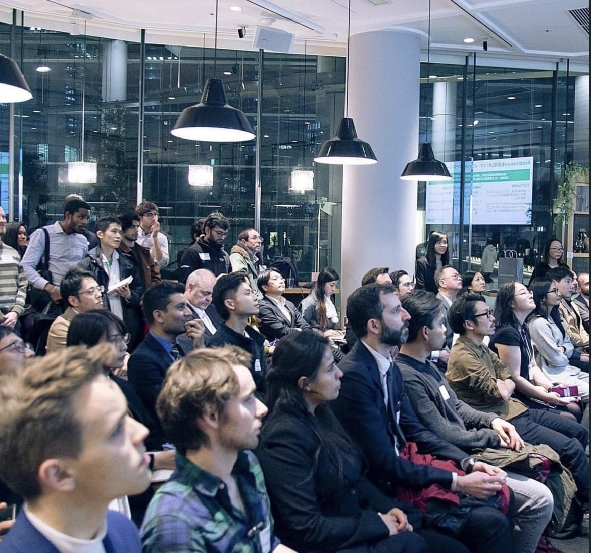
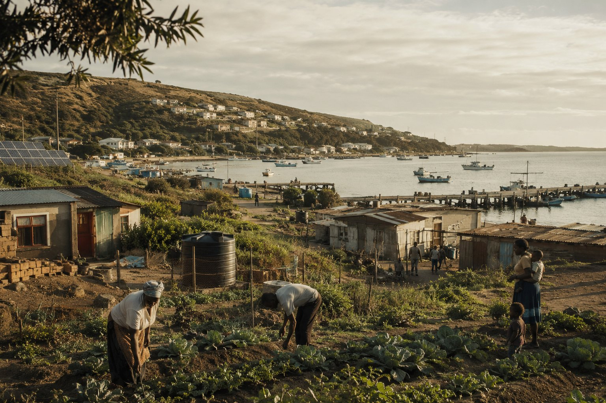
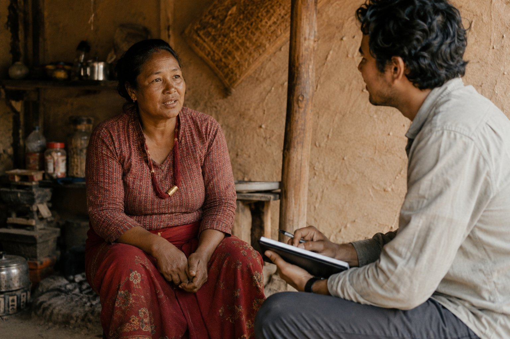
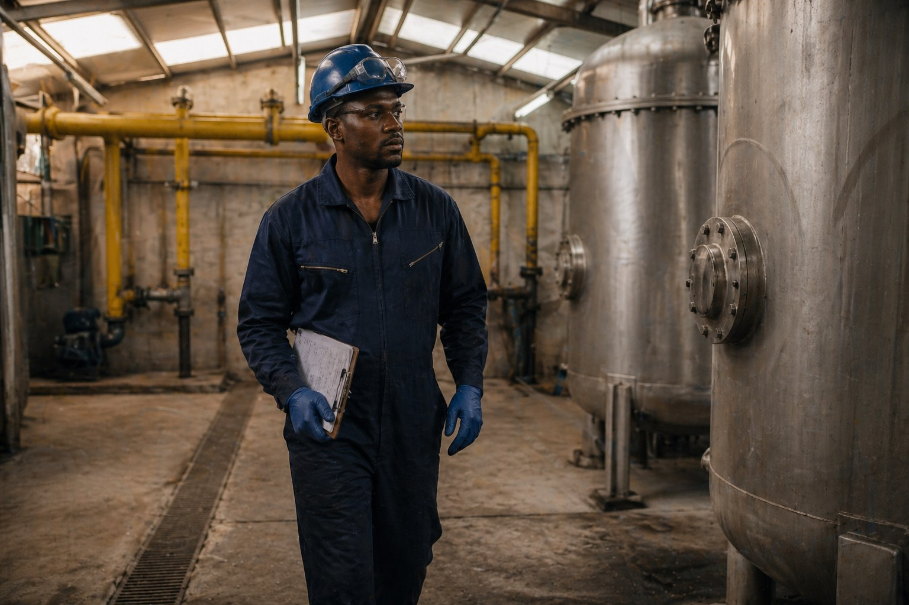
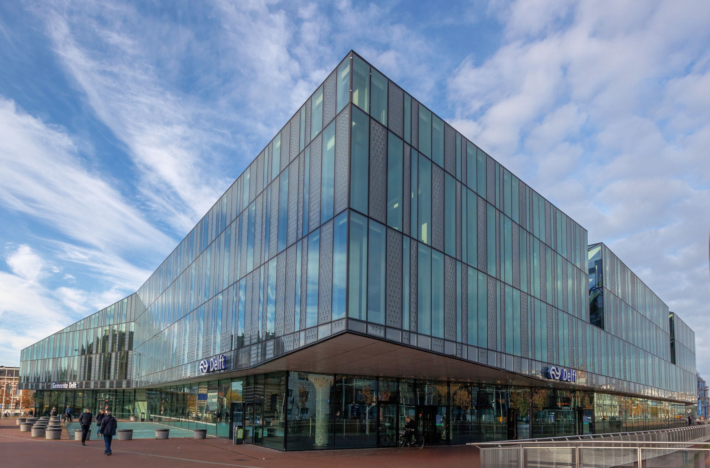
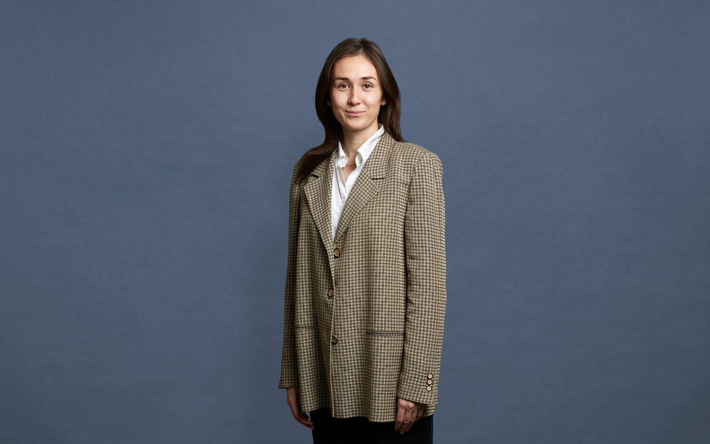
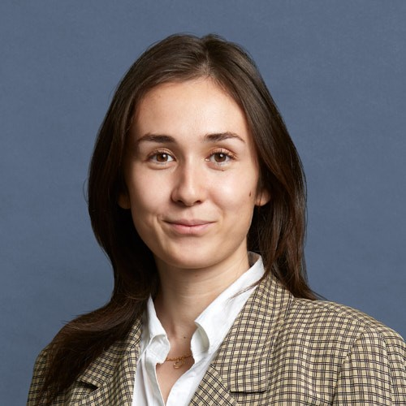

§ / About

# About the Lab

*An independent research team that studies how technologies meet real people, and turns what it finds into evidence institutions and innovators can act on.*

  What we believe
  <h3>The place is the whole argument</h3>
  
A technology only matters when it meets a person, in a place. Not the specification, not the pilot deck, not the aggregate figure. The daily arithmetic of the household, the shift, the field, the shop counter. That is where the Lab starts, and where it reports back to.

<figure>
  
</figure>

---

## The problem we are trying to solve

Every transition of this decade, electric mobility, grid decarbonisation, critical raw materials, water transparency, regenerative agriculture, community-scale monitoring, is specified in a lab, launched in a capital city, and measured in aggregates. It succeeds or fails somewhere else: in the daily arithmetic of a rider's day, a household's bill, a mechanic's income, a council's planning meeting, a mine beside a village. Between the specification and the lived outcome sits an evidence gap, and nobody is systematically filling it.

Promoters measure their own progress and are rewarded for the story. Regulators wait for public complaints. Funders read what beneficiaries are coached to say. The result is a long list of transitions that look good on paper and land poorly in practice, and another list of transitions that quietly work and never get the credit, funding or policy that would let them scale. In both cases, the cost of the gap is paid by the people the technology is supposed to serve.

<figure>
 
 <figcaption>A transition is a collection of daily decisions in places like this one. The Lab exists because almost nobody is measuring those decisions honestly, at the scale the decisions themselves are taken.</figcaption>
</figure>

<section class="statement has-video" style="margin:28px 0 8px;border-radius:var(--card-radius);overflow:hidden;">
  <video class="statement-video" autoplay muted loop playsinline preload="auto" aria-hidden="true">
    <source src="/assets/media/statement.mp4" type="video/mp4">
  </video>
  

  

    <blockquote class="reveal">The gap between what a technology promises and what it actually does in the field is the problem the Lab exists to measure, and to make small.</blockquote>
  

</section>

---

## Our mission

**Generate, publish and apply independent evidence about how transitions actually land**, in the places where they are being lived, and make that evidence usable for the people who have to act on it.

Three commitments hold the mission together:

- **Independence.** The Lab does not accept commissions where a finding is expected in advance. Promoters, funders and regulators all commission us; none of them edit the evidence.
- **Primary field evidence.** The default source is direct contact with the people a technology is meeting. Interviews, observation, counted records on the ground. Secondary data when it answers a question field work cannot, never as a substitute for field work.
- **Open publication.** Field findings publish openly whenever a client's confidentiality allows, with the method, the sources, and the room to be wrong.

<figure>
 
 <figcaption>A field interview in a household kitchen. The Lab's mission runs through a conversation like this one, done well, recorded carefully, and reported honestly.</figcaption>
</figure>

---

## Our vision

A decade from now, every socio-technical transition of consequence carries a public, independent, honest evidence base that a rider, a lender, a mayor, a battery buyer, a resident and a policymaker can share. None of them is beholden to the promoter. All of them read from the same facts, argue about what to do, and act on the facts rather than around them. The gap between what a technology promises and what it does in the field shrinks, because the gap is finally being measured by someone with no stake in the answer.

That is a long horizon. The Lab's part of it is small, specific and measurable: to be the evidence partner a reasonable institution turns to when it needs to know what is actually happening on the ground, and to leave behind, on every engagement, a published trail that outlasts the engagement itself.

<figure>
 
 <figcaption>Technical literacy inside a plant, social-science fieldcraft outside it, held together by the same discipline. The Lab's vision is that these two sit in the same report.</figcaption>
</figure>

---

## Two modes, one method

We **publish our own research** openly: [articles](/articles) on finance, electrification, and water access, and a [signature typology](/brw) of how new infrastructure engages the legacy regimes it enters.

We **work under contract** for organisations that need evidence they cannot generate themselves: [field research](/field-research), [impact measurement](/impact-measurement), and the [European projects](/european-impact-tracking) that need an independent measurement partner.

---

## What makes us different

  Our stance
  <h3>Social science first, technical literacy alongside</h3>
  
Two things that rarely sit in the same room. Social-science fieldcraft that finds out what is actually happening to people. And genuine technical understanding of the systems we study. Policy consultancies hold only the first; technical labs, only the second. The Lab refuses the split.

---

## Where we work

Based in **Delft, The Netherlands**. Low-connectivity, multilingual, informal, dispersed settings. Through researchers and partners who already speak the language and know the place.

<figure>
  
</figure>

---

## How we hold the work

Informed, recorded, revocable consent. Anonymisation by default. Findings that contradict a client's hopes are reported as carefully as those that support them. See [Field Research](/field-research) for the full ethics practice.

---

## The team

  <article class="team-card">
    

      
      
    

    

      <h3 class="team-name">Celine</h3>
      
Legal Consultant and China Expert

      
Celine specialises in corporate, M&amp;A and commercial matters. With legal experience in both the Netherlands and China, she advises on cross-border corporate issues between Europe and Asia. Her Chinese-Dutch background gives her a deep understanding of both business cultures, making her a trusted bridge between East and West. She helps brands, companies and institutions enter new markets, build local partnerships and grow their presence abroad. Precise, driven and committed, Celine goes the extra mile to get the deal done.

    

  </article>

---

*For services, see [What We Do](/what-we-do). For our published thinking, [Articles](/articles). To start a conversation, [Contact](/contact).*
