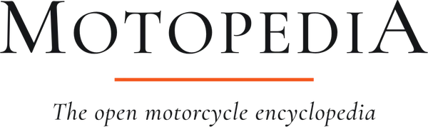
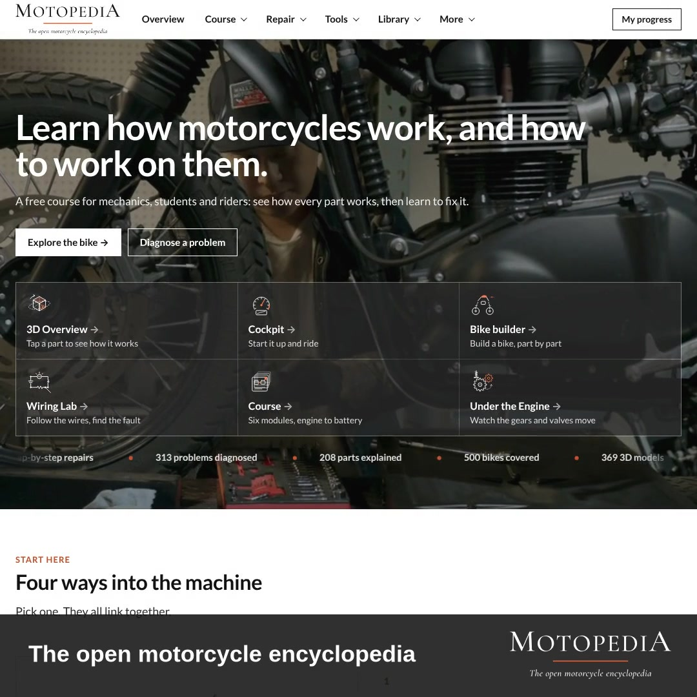
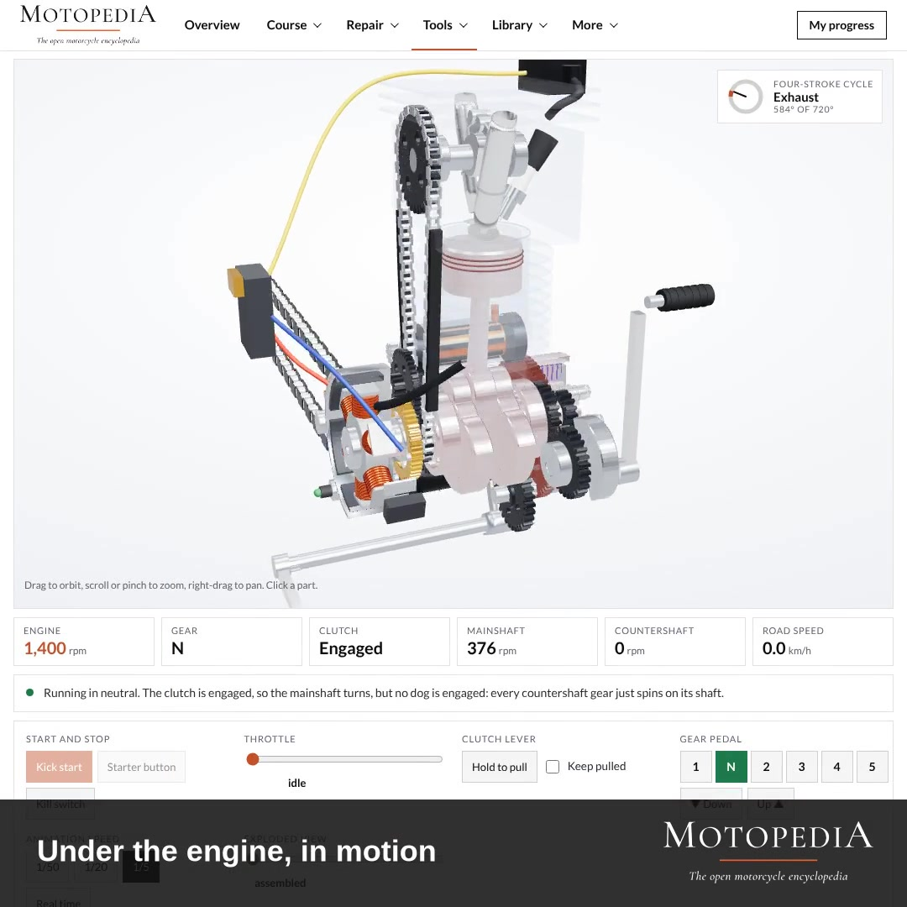

§ / Field case, Electrification &amp; e-mobility

# Learning the Machine: Motopedia and the Open Motorcycle Encyclopedia

*A live field engagement with [Motopedia](https://www.motopedia.org), the open encyclopedia of motorcycles, on a project running to February 2027 that pairs the Lab's Boda Boda field evidence with Motopedia's visual, open-source teaching platform, so riders, mechanics and the people making mobility policy can share one grounded picture of how an electric fleet actually works.*

 
Partner<a href="https://www.motopedia.org" target="_blank" rel="noopener">Motopedia</a>

 
ScopeGlobal open motorcycle encyclopedia (500 bikes, 369 3D models, 208 parts, 300+ diagnosed problems); Lab field anchor in Nairobi, Kenya, on the Boda Boda fleet

 
SectorElectric mobility · informal transport · open educational infrastructure

 
TimelineIn field. Project results published February 2027.

 
Lab programme<a href="/expertise-e-mobility">Electrification &amp; E-Mobility Transitions</a>

## The engagement in one sentence

Motopedia publishes the machine, every part, every circuit, every failure mode, as a free, open, visual encyclopedia; the Lab reads the Nairobi Boda Boda fleet that will decide whether electric two-wheelers cross from novelty into default, and the two pieces fit together into one project that a rider, a mechanic and a lender can all look at and recognise.

<figure class="case-video-figure">
 <video controls preload="metadata" playsinline
        poster="/assets/img/case-motopedia-poster.jpg"
        style="width:100%;max-width:960px;display:block;margin:0 auto;border-radius:6px;background:#111;">
  <source src="/assets/media/motopedia-showreel.mp4" type="video/mp4">
  Your browser does not support the video element. <a href="/assets/media/motopedia-showreel.mp4">Download the showreel</a>.
 </video>
 <figcaption>Motopedia showreel: the open motorcycle encyclopedia, in one minute. Produced by the Motopedia team.</figcaption>
</figure>

## Why this engagement matters

The Lab's work on [electric transport in Nairobi](/case-roam) has returned, again and again, to one thing the engineering papers do not quite capture. A rider's day is held together by a chain of small mechanical judgements, when a tyre is worth repairing, when a battery is behaving, when a chain needs tension, when a stalled engine means ignition or means fuel, and those judgements are learned on the street, from older riders, from roadside mechanics, from the bike itself under the hand. The electric transition does not replace that chain. It rewrites it. A new machine lands in the middle of a learning system that was built for petrol.

Motopedia is a direct answer to that. It is a free, open, visual course and reference for how a motorcycle works and how to work on it, from the four-stroke cycle to the charging circuit, from the piston to the brake caliper. It covers [500 bikes](https://www.motopedia.org), [369 downloadable 3D models](https://www.motopedia.org), 208 parts explained, and over 300 diagnosed problems, held together by a six-module course and a diagnosis tool that walks a mechanic to a likely cause in three taps. One of the 3D bikes in the library is already a Boda Boda commuter 150. This is not accidental. The platform is built with the fleets a classroom-free mechanic actually meets.

Where Motopedia publishes the machine as it is, the Lab publishes the day as it is lived. Together, that produces something neither side can produce alone: an evidence base for Nairobi's electric transition that a rider, a mechanic, a lender, a policymaker and a vehicle manufacturer can share, argue over, and act on.

<figure>
 
 <figcaption>Motopedia home page: four ways into the machine, plus a free course, a wiring lab and over 300 diagnosed problems.</figcaption>
</figure>

## What the project runs on

The engagement that ends with publication in February 2027 is organised around three streams. They share one field, the Nairobi Boda Boda fleet, and feed one open output: an evidence-and-reference base built so that the people who ride, fix, finance and regulate these motorcycles can all read the same picture.

 01 · Field reading on the electric Boda Boda
 
A rolling cohort of Boda Boda riders on both sides of the switch, petrol and electric, interviewed on how the day earns and where it breaks. The Lab's method here is the same one used in the earlier <a href="/case-roam">Crossing the Threshold</a> reading: twenty-plus structured interviews, a mix of riders, roadside mechanics, parts traders, a lender and the manufacturers, with every quote tied back to an entry in a shared protocol. The output is a plain reading of what actually decides whether the switch holds after the first month.

 02 · Shared mechanical layer with Motopedia
 
Where a field finding depends on a component, a circuit or a failure mode, the Lab links the finding directly to the Motopedia page for that part, its 3D model, its fault diagnosis, its wiring. A note that riders cannot read a controller fault code becomes a link to the exact circuit page. A finding that a battery pack fails at a given symptom becomes a link to the symptoms list and the three-tap diagnosis. The intent is that a rider, a mechanic or a trainer who meets the evidence also meets the machine it is about.

 03 · Open publication, February 2027
 
The project results publish openly, under the Lab's standard, no paywall, no unverifiable claim, every figure tied back to a transcript or a counted record. The deliverable is a plain-language report, a dataset card, a set of Motopedia-linked part and circuit pages for the specific electric platform in question, and a short training set a Boda Boda training SACCO can actually use. The Lab's final publication date is February 2027; the training set goes into use before then, as drafts are tested with the rider cohorts.

## What Motopedia brings into the project

Motopedia is not a brochure for a technology. It is a working encyclopedia, produced to a classroom standard but published as a public good. Three things about it matter for the engagement.

<figure>
 
 <figcaption>Eleven bikes in 3D, with every part on the strip clickable. The 3D models are downloadable as .GLB files for teachers, students and workshops.</figcaption>
</figure>

### Eleven bikes, in 3D, free to download

The library covers a cross-section of the real world: a classic four-stroke, a two-stroke commuter, a Boda Boda commuter 150, a step-through underbone, a café racer, a vintage V-twin, a cruiser, a 1000cc superbike, and more. Each is navigable: drag to orbit, scroll to zoom, tap a part to see what it does and how it fails. Each is downloadable as a 3D model file for use in a classroom or a workshop training set. The Boda Boda commuter 150 in the library is already the kind of machine a Nairobi rider recognises before reading the label. This is the point of convergence between Motopedia's catalogue and the Lab's field evidence.

<figure>
 
 <figcaption>Under the Engine, in motion. The crankshaft turns, the valves open on cue, the gears show whether they are engaged or just spinning. Hold the clutch lever to unload the mainshaft; it is a 3D model you can drive.</figcaption>
</figure>

### The engine, visibly, mechanically, working

Where most online motorcycle learning stops at an exploded parts diagram, Motopedia keeps going. The Under the Engine viewer animates the full four-stroke cycle in 3D with the clutch and gearbox hooked up correctly. A rider who has been operating a kick-start for years can watch the inside of their own routine happen. For the Lab's purposes, this changes what a training session can contain: a Boda Boda training SACCO can show, not describe, what a rider is doing when they slip a clutch or stall on a cold start.

<figure>
 
 <figcaption>Wiring Lab, charging circuit. The schematic is live: change the engine speed, watch the regulator shunt current to earth to hold 14.5 V at the battery. Every branch lists its job, how to test it, and how it fails.</figcaption>
</figure>

### The circuits a rider meets, as live schematics

The Wiring Lab pulls the ignition, starting and charging circuits off the page and makes them live: currents flow, regulators clip, loads draw, the battery charges or does not. A Boda Boda rider who has been told the battery is not holding charge can see, in one diagram, whether the fault is in the alternator, the regulator, the battery, the harness or the loads. For the Lab, this is a direct answer to a recurring field finding: on petrol or electric, the thing a rider most often cannot verify is the electrical system, and the most expensive unnecessary parts replacement in the fleet.

<figure>
 
 <figcaption>Diagnose a fault in three taps. The tool walks from the bike, to the location, to the symptom, to a likely cause and a test procedure, with references to the matching part pages.</figcaption>
</figure>

### Fault diagnosis as a working tool, not a search engine

The diagnosis tool does the job a roadside mechanic does, three taps and a working hypothesis. It is not a search engine for keywords; it is a decision tree built from the actual fault patterns in the parts catalogue. For the Lab, this matters because it maps directly onto the question field evidence keeps asking: when a rider loses a day, where does the day go, and what piece of information would have saved it.

<figure>
 
 <figcaption>Cockpit and Dyno. Start the bike from the saddle; the dyno records at 20 samples a second and exports a CSV. A teaching simulation, not a specific bike's figures, but close enough to read the shape of a transition from petrol to electric.</figcaption>
</figure>

### A cockpit that reads back

Motopedia's Cockpit lets a learner ride the bike from the saddle, key, choke, clutch, gears, throttle, brakes, with an attached dyno that writes out speed, rpm, throttle, brake, gear, clutch and power at 20 samples a second. The data exports as a CSV. For the project, this is what the training sessions use to make the comparison that petrol-trained riders most want to run: on the same throttle input, how does an electric drivetrain respond, how does the torque curve feel, how is the regen different. Not as a brochure, as a dyno trace.

<figure>
 
 <figcaption>369 3D models, free to download. The Boda boda commuter 150 (second tile, top row) sits in the same library as the pioneer motor-bicycle, the vintage V-twin and the modern superbike, the same fleet a Nairobi mechanic walks past every day.</figcaption>
</figure>

### Open, downloadable, teachable

Everything on Motopedia is free to look at and use. The 3D models can be downloaded as GLB files. The course materials can be read without logging in. The diagnosis tool is public. For a project meant to leave behind a training set a Nairobi SACCO can keep using, this is the material difference between a glossy report and an actual working platform.

## What the Lab brings into the project

Motopedia covers the universal machine. The Lab reads the particular fleet, under its actual operating conditions. The method is the one that runs across every Lab engagement: not a survey, not a model, but interviews, counts and shadowing, done by people who ride on the back of the motorcycle for the day.

 The Lab's working discipline on this project
 
Three guardrails hold across the field work. One, every quantitative claim traces back to a counted record, not to an estimate. Two, every quoted interview line is tied to an entry in a shared protocol; if we cannot cite the exchange, we do not use the line. Three, the machine description in the final publication must match the Motopedia entry it refers to; any discrepancy is corrected before publication rather than annotated around. The three together are what distinguishes a reading from a brochure.

The reading will carry across the categories the Lab has used in every previous mobility engagement: the economics of a day, the reliability of the vehicle, the availability of the after-sales network, the lived pattern of charging or refuelling, and the financing architecture that lets a rider own the vehicle in the first place. What is new, specific to this project, is that every mechanical finding comes with a working reference a reader can open.

## What the project does not promise

The Lab does not evaluate Motopedia. It does not benchmark one platform against another, and it does not grade the pedagogy. Motopedia is the open mechanical layer on top of which the field reading is published. The field reading is independent of any vehicle, any manufacturer and any training provider, and its findings will land where they land.

The project also does not promise a national training deployment. It commits to one thing, the Lab's standard deliverable: open, verifiable field evidence, published in February 2027, that a reader can take into whatever decision they are actually facing.

## Why this fits the Lab's wider body of work

Across the Lab's electric-mobility engagements, from the [Crossing the Threshold case in Nairobi](/case-roam) through the [Market-Entry study in East Africa](/case-context-entry), one finding keeps surfacing: the vehicle is almost never the hard part. The hard parts are the financing architecture, the after-sales network, the fuelling or charging ritual, the household economics, and above all the mechanical knowledge the fleet is built on. The partnership with Motopedia is the first time the Lab has worked with a partner whose explicit mission is that last piece.

For the Lab, the project also doubles as a test of a broader method. If a field reading is made more useful by being linked to a working mechanical reference, that is a template that can carry across other sectors, not only electric mobility.

<figure>
 
 <figcaption>A full course, with the maths. Six modules, from the anatomy of the machine to the electric drivetrain, with equations, worked examples and an end-of-module quiz. Free, open, no login.</figcaption>
</figure>

## In summary

Motopedia publishes the open motorcycle encyclopedia; the Lab publishes the rider's day. Both are evidence. The project ending in February 2027 holds them together so that a Nairobi Boda Boda rider, a mechanic, a lender and a policymaker have a shared, verifiable picture of what an electric fleet actually is, how it works, how it fails, and what it earns.

The rest of the Lab's body of work in the sector sits alongside this one: [Crossing the Threshold](/case-roam) for the household economics, [Market-Entry in East Africa](/case-context-entry) for the pre-capital reading, and the Lab's shorter [field insights](/articles) for what we are seeing between projects. If you work in this sector and want to talk about where the project is heading, or how a related reading might fit into your own decision, see [Contact](/contact).

---

*Partner profile: Motopedia is the open motorcycle encyclopedia at [motopedia.org](https://www.motopedia.org). It covers 500 bikes, 369 downloadable 3D models, 208 parts explained, 313 diagnosed problems, and a six-module free course. The platform is produced by the Motopedia team; the showreel above is theirs. The Lab's engagement with Motopedia is an independent research partnership for the Boda Boda project; the Lab does not evaluate the platform.*
