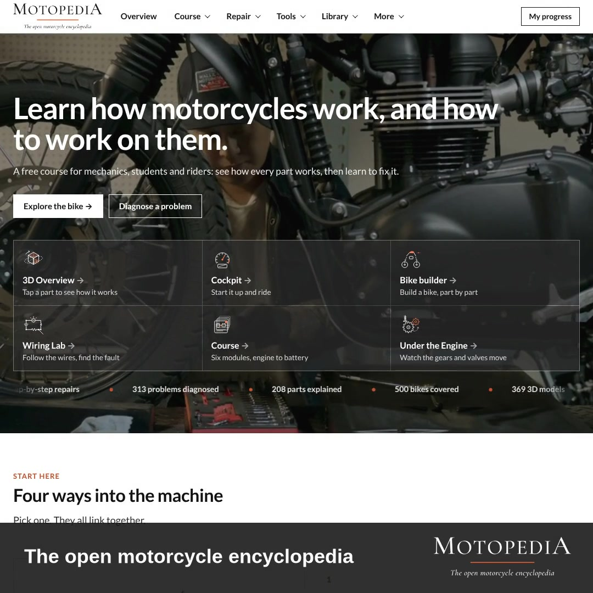
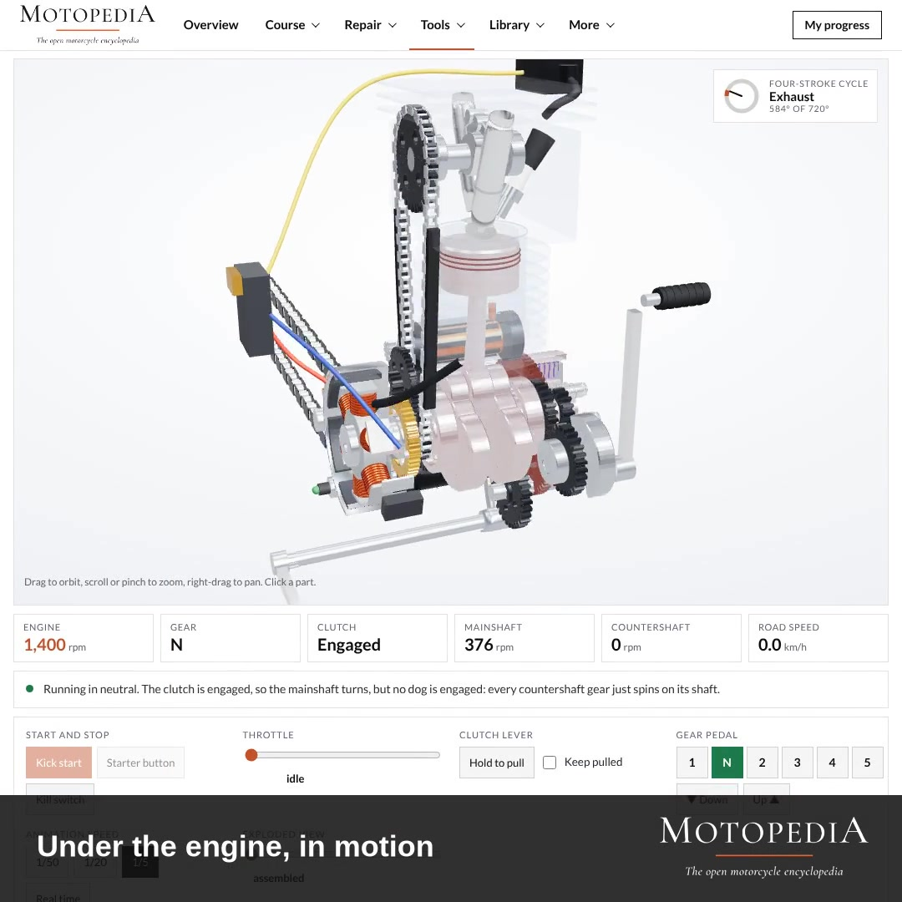

§ / Insight, Electric mobility &amp; open infrastructure

# An Encyclopedia for the Two-Wheeler

*A rider learns the motorcycle from the road. A mechanic learns it from the kerb. Almost nobody learns it from a textbook. So when the fleet turns electric, the question is not whether the new machine is better. It is whether the learning system around it can keep up.*

9 November 2026 · 4 min read

<figure>
 
 <figcaption>Motopedia, the open motorcycle encyclopedia: 500 bikes, 369 3D models, 208 parts, 300+ diagnosed problems, free to use.</figcaption>
</figure>

## The thing the engineering papers miss

If you spend a few days in Nairobi reading the Boda Boda fleet, two things are true at once. The engineers' papers on electric two-wheelers are mostly correct; the range is adequate, the torque curves are ridable, the battery packs are affordable on the right financing. And the papers do almost nothing to explain why the switch is slow in some corridors and fast in others, why some riders go back to petrol after a month, why some batteries last twice as long as others under the same badge.

The gap is the same one that showed up in cookstoves twenty years ago, and in solar home systems ten years ago. The technology is one factor. The system around it, financing, after-sales, parts, trust, is another. And inside that system is a fourth element that quietly carries more than its share of the weight: the mechanical knowledge the fleet is built on. The old knowledge was learned on petrol, on carburettors, on kick-starters, on chains and sprockets, from older riders and roadside mechanics. The new machine is electric, lives on the controller and the pack, and the knowledge is not yet there.

## Why Motopedia is the right kind of thing to notice

There is now a free, open, visual motorcycle encyclopedia at [motopedia.org](https://www.motopedia.org). Not a brochure, not a parts catalogue, an encyclopedia. It covers 500 bikes, including a Boda Boda commuter 150. It has 369 3D models downloadable as GLB files. It has 208 parts explained, 313 diagnosed problems, a six-module course with the maths, a Wiring Lab where the circuits run live, a Cockpit where you can ride the bike from the saddle, a dyno that writes a CSV, and an Under the Engine viewer where the four-stroke cycle actually turns.

All of that is public. All of it is free. None of it is behind a login.

That matters because the motorcycle learning problem is not a lack of information in the world. The data sheets exist. The service manuals exist. The engineering textbooks exist. What has not existed, until now, is a place where the machine is published as a working object a mechanic can orbit, poke, run and fail, in a browser, from a $50 phone.

<figure>
 
 <figcaption>Under the Engine, in motion. The four-stroke cycle turns in the browser. Pull the clutch, change gears, watch the mainshaft and countershaft go in and out of lock.</figcaption>
</figure>

## What an encyclopedia does that a brochure cannot

A brochure describes what a product does. An encyclopedia describes how a class of objects works. The difference is not cosmetic. A brochure trains a customer; an encyclopedia trains a mechanic. A brochure sells; an encyclopedia explains. A brochure is written for the launch; an encyclopedia is written to hold up on year four.

For a transition, the second is much more useful than the first. Year one of an electric Boda Boda is a sales story. Year four is a maintenance story. Year four is where cookstoves failed. It is where many solar home systems failed. It is where any electric fleet will be tested, not on the showroom floor but in the roadside workshop on a wet Tuesday, when a rider has lost half a day and a diagnosis to the wrong replaced part.

A working encyclopedia is one of the quiet pieces that lets year four hold.

## What field research adds, and what it needs

A platform like Motopedia is necessary and not sufficient. You can publish the machine, but you still have to study the fleet. The Lab's work on the Nairobi Boda Boda transition keeps returning to the same evidence: the vehicle is almost never what decides whether the switch holds. The household economics decide it, the charging ritual decides it, the financing architecture decides it, the after-sales network decides it. The vehicle sits inside all of that and is judged by it.

What the field reading needs, in return, is a working reference. When the interview turns up that a rider cannot verify a battery fault, the finding is more useful if it points at the exact circuit page a mechanic can open on their phone. When the finding is that a stall at a cold start is being blamed on the ignition and is actually the choke, the finding is more useful if it points at the Cockpit sequence a trainer can walk through. The two sides of the evidence, the field and the machine, need to reach each other.

That is the point of the Lab's new engagement with Motopedia, [published as a field case here](/case-motopedia), with the project results due in February 2027. The Lab publishes the day as it is lived; Motopedia publishes the machine as it is. Together they produce something neither side can produce alone.

<figure>
 
 <figcaption>Wiring Lab, charging circuit, live. Change the engine speed, watch the regulator shunt current to earth to hold 14.5 V at the battery. The kind of page a roadside mechanic can read on a phone.</figcaption>
</figure>

## Three small things this changes

If a working encyclopedia is now part of the infrastructure, three things move.

**A field finding can carry its reference.** A statement in a Lab report about a controller fault is linked to the Motopedia page for the controller and to the three-tap diagnosis. A statement about regenerative braking is linked to the Cockpit page where a reader can feel it. This is the small change that turns evidence from a claim into something a reader can inspect.

**A training set stops needing to be rebuilt every project.** For years, every e-mobility training programme in East Africa has produced its own slides, its own manuals, its own videos, and those materials have aged out with the next vehicle generation. A shared encyclopedia that is itself kept current changes the maths: the project's materials become small, specific to the fleet, and point at the encyclopedia for the rest.

**A rider's curiosity has somewhere to go.** A rider who wants to understand why their new electric drivetrain feels different on a hill is currently told, mostly, that they do not need to understand it. That is the wrong answer. A fleet that understands its own machine is a fleet that lasts.

## In one line

An encyclopedia is not news. An open, visual encyclopedia of the motorcycle, published free, that renders the circuits live and the engines in motion, is. If the electric transition in the places where a mechanic learns on the street is to hold past the launch cycle, the knowledge layer has to come with the hardware. Motopedia is one of the first pieces of that infrastructure in the open, and it is why the Lab is now publishing jointly with it.

---

*Related reading from the Lab: the [Motopedia field case](/case-motopedia) covers the full engagement running to February 2027. Earlier work on the same transition sits in [Crossing the Threshold: Electric Transport in Nairobi](/case-roam) and the [Market-Entry study in East Africa](/case-context-entry). For how a Lab study is designed, see [How It Works](/how-it-works).*
