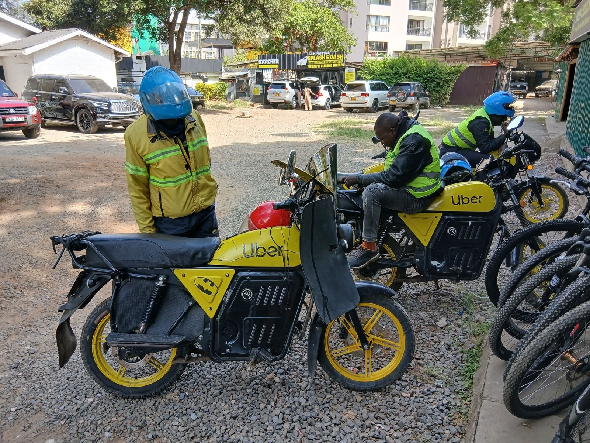
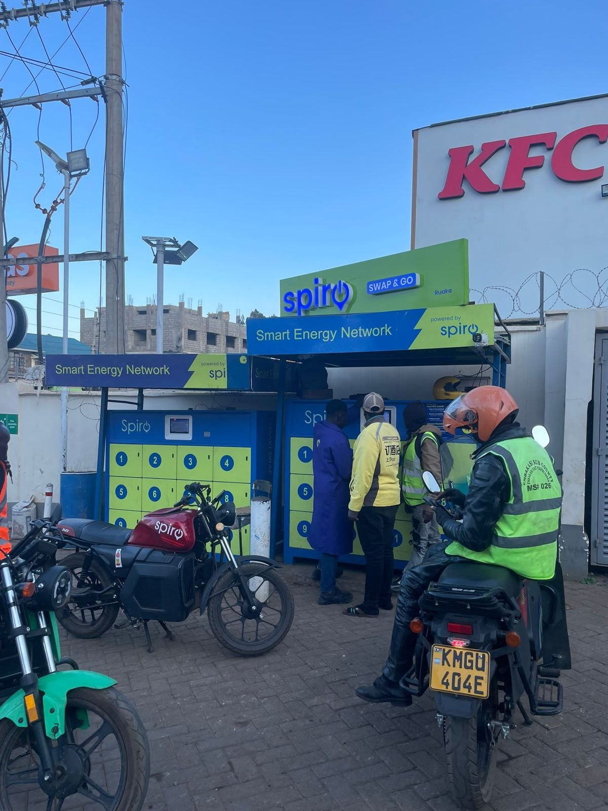
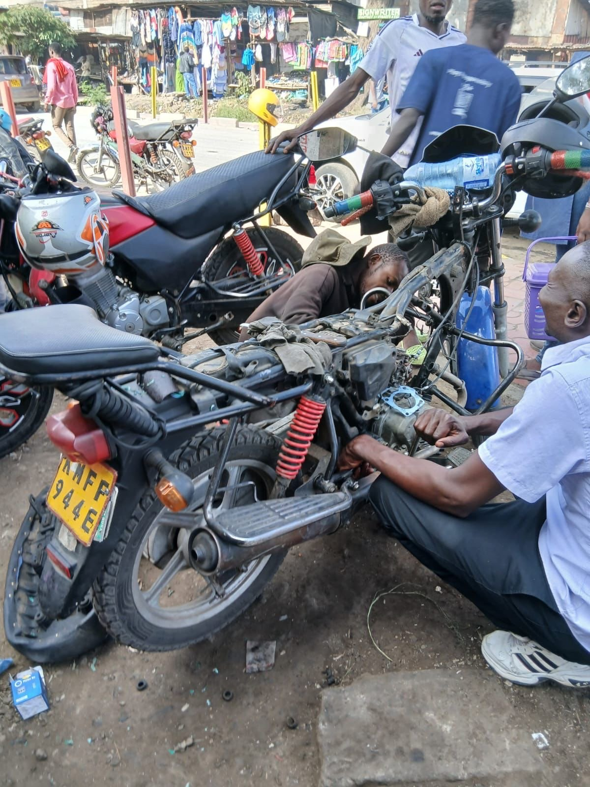
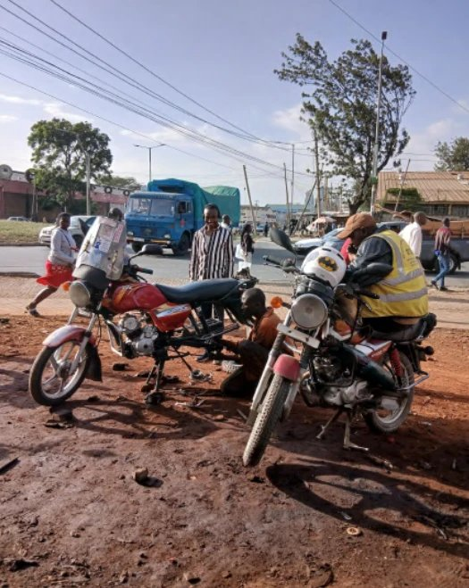
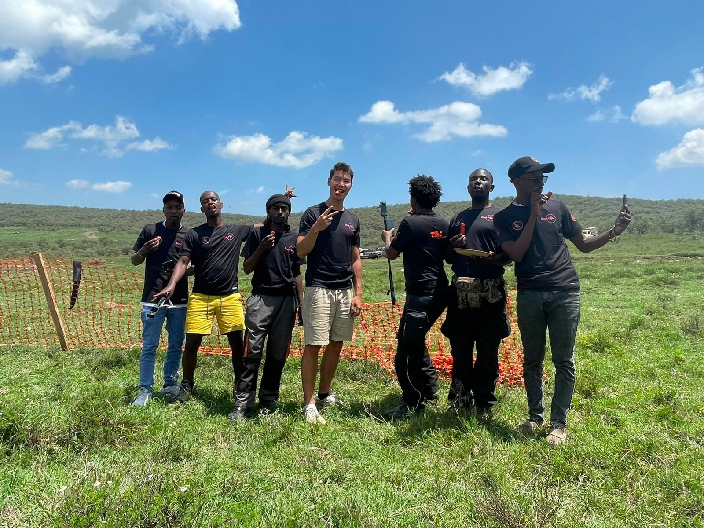
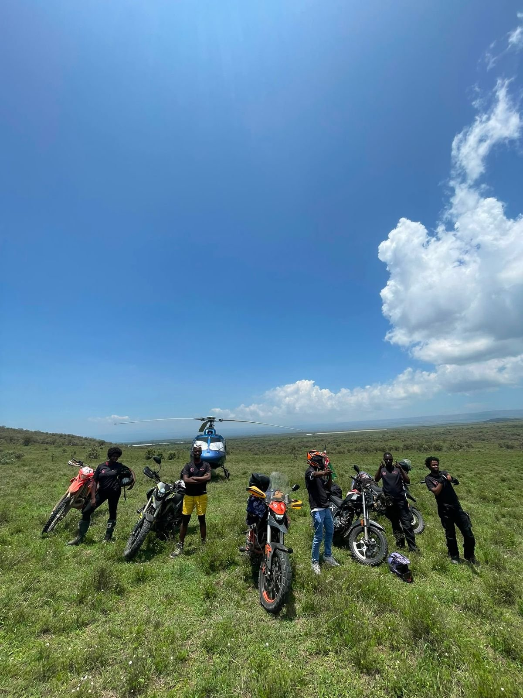
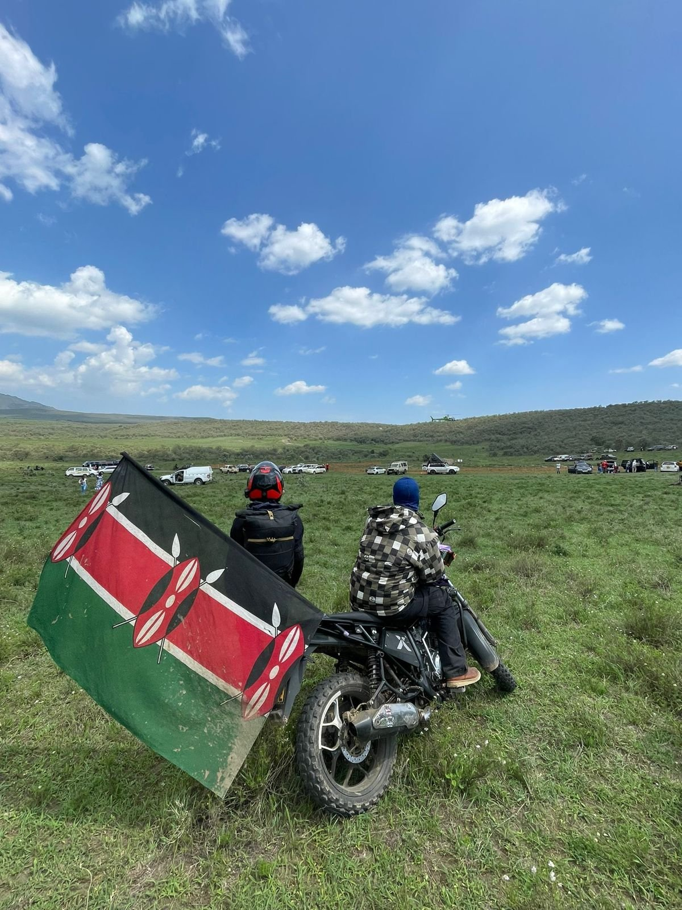
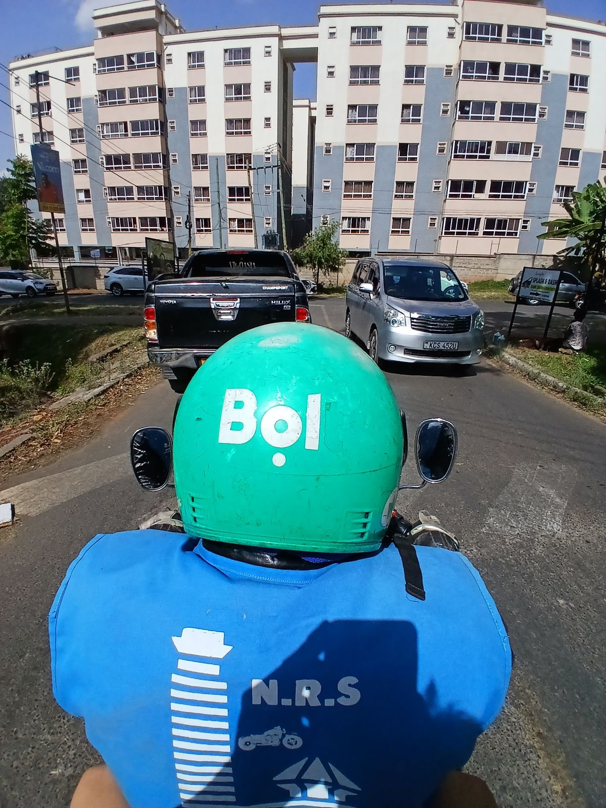

§ / Op-ed, Transport, Africa

# Four Hours at the Hub: Time Is the Real Fuel of Nairobi's Electric Boda Bodas

*Kenya's electric motorcycle story is told per kilometre. On the back of a Roam bike, and at the hub, it reads very differently. A rider earning 530 shillings a day cannot spend four of them waiting for a battery to charge.*

1 November 2026 · 5 min read

<figure class="article-figure">
  
</figure>

## The quiet and the wait

The first thing I noticed, on the back of an electric boda boda in Nairobi this January, was that I could hear the rider. On a petrol bike any conversation dies under the engine. On an electric one you can ask a question at a junction and get an answer before the lights change. The second thing came later that week, at a Roam hub, where riders were lying across their seats in the middle of the working day, waiting for batteries, during hours they would normally spend carrying passengers.

I spent January and February 2026 in Nairobi interviewing ten Roam riders, two petrol riders, three mechanics, a sales agent from the asset financier M-KOPA, and Romain from Roam's leadership team. I came with a question list built around upfront prices, loan terms and range anxiety — the headline topics in Kenya's e-mobility debate. The riders answered patiently, and then, unprompted, kept steering me back to something my list had barely covered: time.

A transition that looks settled on a spreadsheet looks much less settled from the seat of a parked bike at ten in the morning. That gap is where the next phase of this story will be decided.

## Cheap per kilometre, expensive per hour

The case for electric is almost always made per kilometre. In a [Citizen Digital segment](https://www.citizen.digital/article/the-e-mobility-race-how-economical-are-electric-motorbikes-over-petrol-powered-ones-n349845), eWaka co-founder Jimmy Tune said it plainly: "the total cost of ownership today is cheaper on an EV than a petrol bike." The riders agree. Georg, who rode petrol for years before switching, was emphatic: "I'm not saying this to market Roam, but honestly... with the electric bike, you save more." The registrations back him up: [25,277 electric motorcycles among the 168,286 motorcycles registered in Kenya in 2025 — roughly one in seven](https://cleantechnica.com/2026/02/09/electric-motorcycles-reach-15-3-market-share-of-new-registrations-in-kenya-in-2025/).

The arithmetic reverses when you count it per hour. Francis pays 530 shillings a day for two years to own his bike; if he stops paying, "they will come and take their bike." A repayment like that has to be earned when passengers are on the road — the morning rush. Georg described how that window collides with the charging cycle:

> "From five to nine, there's around three to four hours... After that, I have to go to the Roam hub and sit down and wait for around three and four hours for my \[batteries\] to be charged. That's waiting, wasting a lot of time."

When a rental battery is in stock, Francis told me, "it's about 10 seconds, you exchange, and you go." When it isn't, those ten seconds become an afternoon. Enos — who works twelve-hour days and could do thirty trips "if I'm able to swap batteries in time" — waits up to four hours "because so many people are scrambling for all these batteries." He didn't dress it up: "it absorbs my morale, morale goes down. I cannot work as I woke up." Emmanuel put it most plainly — "for boda boda riders, time is actually money" — and Alex, when I asked what petrol riders still have over him, didn't mention price or range: "The only advantage they have from us is they don't wait for batteries."

<figure class="article-figure">
  
</figure>

## When success creates the queue

The waiting is partly a symptom of success. Emmanuel switched early, back when "there were a lot of charging stations... getting access to a rental battery or a loaner battery was quite easy." He paused. "That time, now it's different. Now it's quite hectic." Every new rider makes the bike more familiar to the next one — and draws on the same pool of charged batteries at the same hubs during the same morning rush.

Romain described the squeeze without flinching. A shortage of battery stock had led Roam to sell new bikes with one battery rather than two, which pushed more riders onto rentals exactly as the rental pool was being stretched. Adding batteries alone wouldn't solve it either: "if we don't have the charging points, then you cannot charge them, and that's useless." A container was due the following week — "at least 50 battery or 70 battery in the network." Fifty to seventy is a meaningful injection for one operator. It is also a reminder of how thin the margin is between a network that feels abundant and one where Enos spends a third of his day on a bench.

## A daily clock

What turns waiting from an inconvenience into a cost is the way these bikes are paid for. Romain estimated that "98% of new boda boda will go to a financier" — few riders have the cash unless family support them or they have "sold a piece of land." Terry, who sells electric bikes for M-KOPA across five brands, walked me through the terms: deposit, then a daily payment over two years, three-day grace period on a missed one. He was proud that "90% of the riders pay well on time, every day," and said agents try to match the bike to the rider's earnings — someone making 500 shillings a day is pushed towards a bike at 300 a day rather than 500, because the rider "also need\[s\] money for food, money for basic needs."

That's careful lending. It also means the day starts with a sum owed before any income is counted. Francis described his target in exactly those terms — ten trips at around 50 shillings each, sometimes twelve or thirteen, "to make your target." Every hour at a hub is an hour in which that sum still has to be found. The waiting falls hardest on the riders with the least slack. Georg told me about a friend whose Roam bike had stood idle for four months while he waited on an insurance claim for a faulty motor and controller, "really struggling on how to make money and how to feed his family." Because electric repairs stay with the manufacturer, there is nowhere else to go. James, who runs a workshop with seven mechanics, sees perhaps two to four electric bikes a day out of fifteen — and Francis was clear he would not let "anybody" handle a mechanical fault on his Roam.

<figure class="article-figure">
  
</figure>

## The view from the petrol stage

The petrol riders I interviewed were not waiting for anything. Derro, who spends around 500 shillings a day on fuel, said an 80-km range "is not enough" because "one day you do more than 100," and his conditions for switching were concrete: a rise in the petrol price, fuel becoming "hard to get, and hard to buy," or someone else covering the cost. Mike, with seven years on petrol, was far more hostile and asked that whoever brought electric motorcycles to Nairobi "kindly, please take them off the road." His complaint wasn't about the motor. It was about newcomers entering the trade on financed bikes without licences, and about brakes he considered unsuited to Nairobi traffic.

The friction runs both ways. Alex, riding electric for a ride-hailing app, said petrol riders in the CBD "don't like the electric motorbike" — and the real reason wasn't technical: "For us, we don't wait for customers. They call us," and "they don't like us because we are cheaper." The irony: the rider who no longer waits at a stage for passengers now waits at a hub for batteries. The scarce resource in both cases is his hour. The technology shifts where it is spent, not whether.

<figure class="article-figure">
  
</figure>

## The tank that holds nothing

The eWaka bike in that Citizen Digital segment has a fuel tank that holds nothing, with the charging port where the filler cap would be. "The design is meant to mimic what people are used to," Tune explains. Hargadon and Douglas (2001) called this *robust design* — Edison made the electric light resemble the gas lamp it replaced so a new technology could enter a market organised around the old one. Kenyan e-motorcycles have done this well at the level of the object. What the empty tank cannot imitate is the system behind it. Derro, with no plans to switch, put his finger on it: "petrol stations are all over." In the multi-level perspective's terms (Geels, 2002), the incumbent regime's advantage is less in the engine than in a refuelling network that already moves at the pace of a working day.

Romain was open about where that pace breaks down. The first-generation home charger takes about five and a half hours for a full battery — fine overnight, useless at ten in the morning. "It's our fault as a company," he said. "We have been a bit slow to deploy more rental battery." He also observed that riders were "wasting four hours of their prime time to wait. But they're still like, okay, they still do it" — which he put down to a *hakuna matata* temperament. I read the same scene differently. Riders who owe 530 shillings by evening have little choice. Enos's falling morale is a contractual obligation, not a mood.

<figure class="article-figure">
  
</figure>

## Counting the hours

Kenya's incentives so far have worked on the purchase price — the import and excise exemptions, VAT off batteries — and the registration figures suggest they've worked. The next constraint is the hours between batteries. It appears nowhere in the figures we use to judge progress. Romain argued that owning the battery gives riders "freedom" to "charge everywhere to go anywhere" — true overnight. By day, a rider with one battery is tethered to the hub as tightly as any swapping customer. He was candid that the industry's answer is unsettled — swapping is "so chaotic... It works. It's not ideal, but it works" — and placed his hopes on a new battery that fast-charges from empty to full "in one hour and 20 minutes, instead of five hours." If that holds, Georg's three-and-a-half-hour break shrinks to a long lunch.

Three changes would treat time as the cost riders already know it to be. **Measure it** — report average waiting time per swap or top-up alongside registrations, so a hub network growing slower than the fleet shows up as a problem before it shows up as falling morale. **Fund the wait**, not the sticker — direct the next round of support to rental battery stock, fast chargers at existing hubs and grid connections where riders already gather, rather than only to the price of the bike. **Make batteries and stations work across operators**, so a rider short of charge in the morning rush isn't restricted to one company's hubs. None of this is new. Riders themselves suggested most of it. Alex put the whole agenda in a sentence: "Just improve on the rentals, add more rentals, and swap stations."

The quiet I noticed on that first ride is real. It is one of the pleasures of an electric city. The riders lying across their seats at the hub were quiet too, for less pleasant reasons, and if the transition is to hold beyond its early adopters, their hours deserve the same attention we have given their shillings.

## A postscript, from the grass outside the city

The research is one half of what Kenya gave me. The other I owe to the riders, mechanics and friends who put me on the back of a bike, took me out to the Safari Rally and left me grinning in a Naivasha field — but that is a story for another time.

  <figure class="article-figure"></figure>
  <figure class="article-figure"></figure>
  <figure class="article-figure"></figure>

## References

- Geels, F. W. (2002). Technological transitions as evolutionary reconfiguration processes: a multi-level perspective and a case-study. *Research Policy*, 31(8-9), 1257-1274. [doi:10.1016/S0048-7333(02)00062-8](https://doi.org/10.1016/S0048-7333(02)00062-8)
- Hargadon, A. B., & Douglas, Y. (2001). When innovations meet institutions: Edison and the design of the electric light. *Administrative Science Quarterly*, 46(3), 476-501. [doi:10.2307/3094872](https://doi.org/10.2307/3094872)
- Kuhudzai, R. J. (2026, 9 February). [Electric motorcycles reach 15.3% market share of new registrations in Kenya in 2025](https://cleantechnica.com/2026/02/09/electric-motorcycles-reach-15-3-market-share-of-new-registrations-in-kenya-in-2025/). *CleanTechnica*.
- Musau, D. (2024, 19 September). [Just how economical are electric motorbikes over petrol ones?](https://www.citizen.digital/article/the-e-mobility-race-how-economical-are-electric-motorbikes-over-petrol-powered-ones-n349845) *Citizen Digital*.
- Author's interviews with ten Roam riders, two petrol riders, three mechanics, an M-KOPA sales agent and Roam leadership, Nairobi, January–February 2026.

*Interview quotes are lightly edited from transcripts for readability; ellipses mark omitted words.*

---

*This is an independent op-ed by Transitions Lab. See the companion field essays [Hands Never Still: the jua kali fundis Nairobi's electric transition cannot afford to lose](/insight-hands-never-still) and [The Hidden Energy Economy: what Nairobi's unofficial battery chargers say about the swap network](/insight-hidden-energy-economy). For the Lab's applied work, see [E-Mobility &amp; Transport](/expertise-e-mobility). To discuss a study, see [Contact](/contact).*
