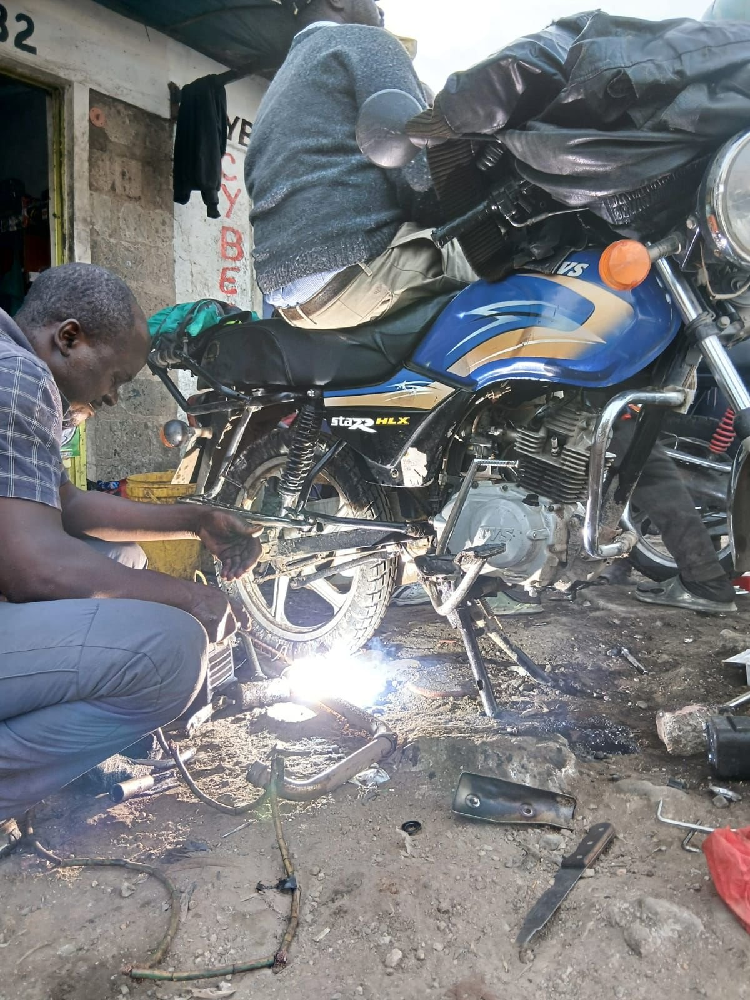
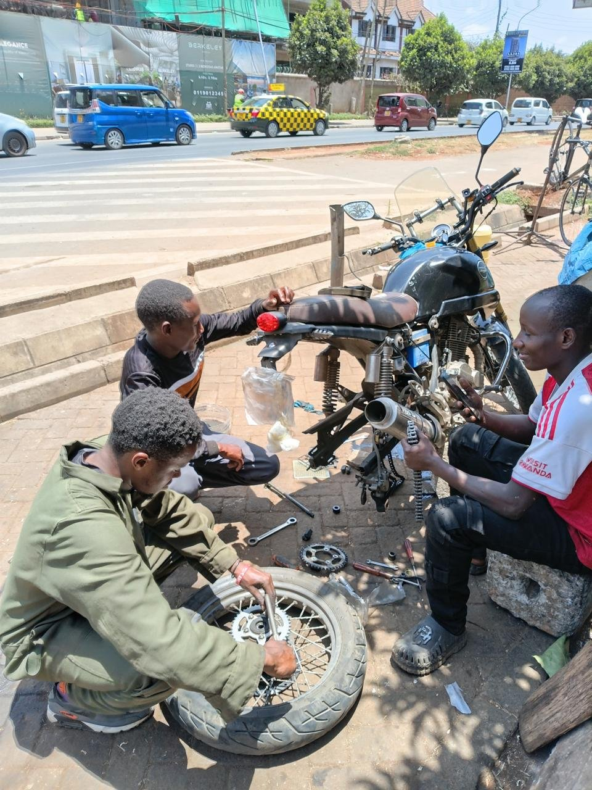
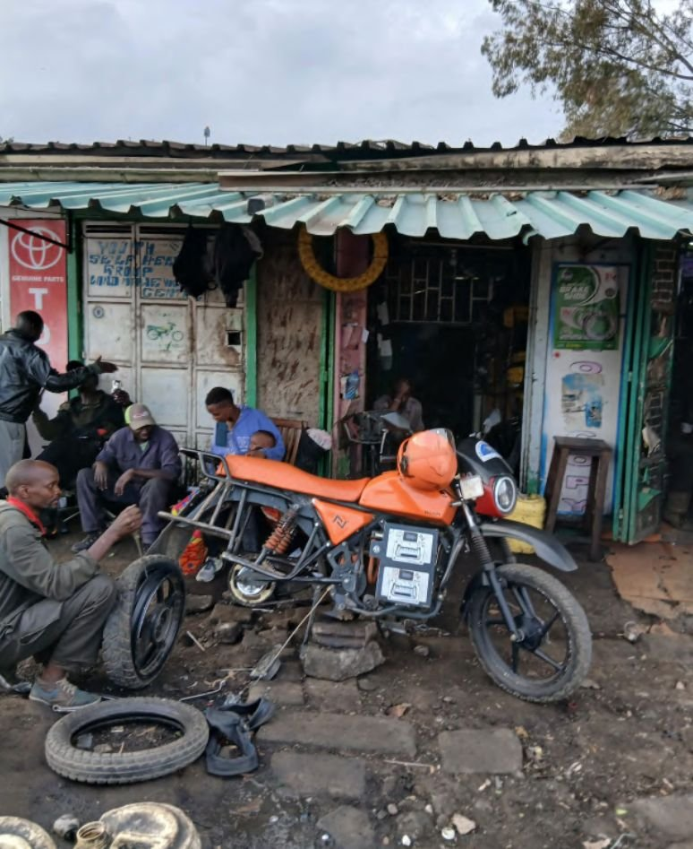
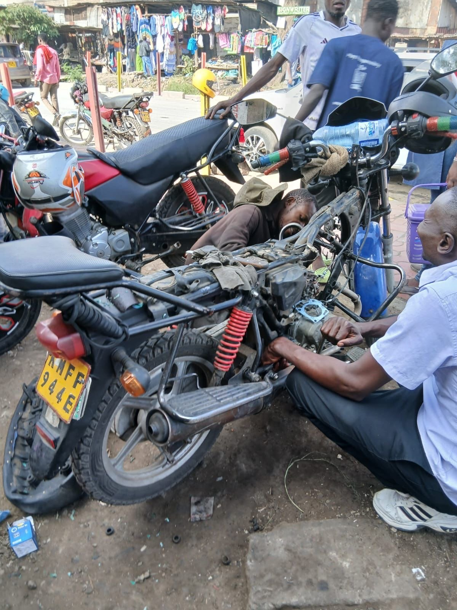
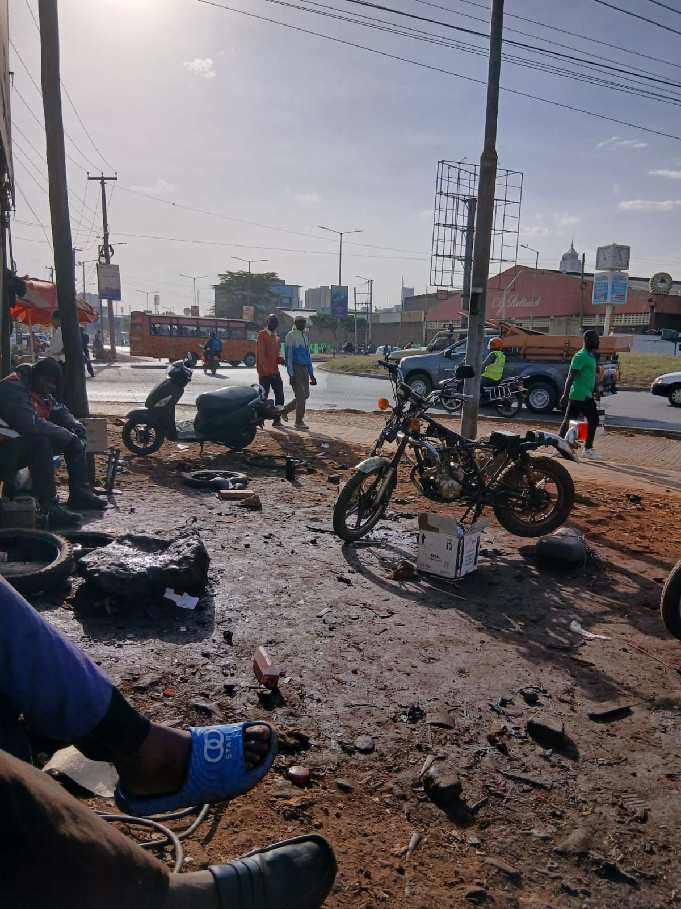

§ / Op-ed, Transport, Africa

# Hands Never Still: The Jua Kali Fundis Nairobi's Electric Transition Cannot Afford to Lose

*Nairobi's informal mechanics keep boda bodas running on an open market of Indian originals and Chinese copies. Electric motorcycles route repair through operators' service centres instead, and the fundis along the road are being left on the kerb.*

1 November 2026 · 6 min read

<figure class="article-figure">
  
</figure>

## Interviews over a workbench

The people with the most time to talk, during my Nairobi fieldwork, were the riders lying across their seats at the charging hubs. The people with the least time were the mechanics. Across two rounds, January to February and September to October 2026, every mechanic I interviewed kept working while I asked my questions, and I learned to hold the recorder close to a pair of hands rather than to a face. One was patching an inner tube: rasping the rubber around the hole, brushing on solution, pressing the patch, dunking the tube in a basin to watch for bubbles. Another was loosening the rear axle to slide the wheel back on its adjusters and take the slack out of a chain that had started slapping the swingarm. A third had the head off a 150cc petrol engine, piston and rings laid out on a rag, a feeler gauge ready for the valve clearances, customers waiting on the kerb for a bike that would carry passengers again by the afternoon.

That contrast of idle riders and busy mechanics is one of the clearer signs of how Kenya's electric transition is reorganising work. My earlier piece argued the scarce resource for riders is time at the hub. This one is about the people whose time was never scarce enough to waste: the *jua kali* fundis who keep the city's motorcycle taxis on the road, and what happens to them when the bikes stop running on petrol.

<figure class="article-figure">
  
</figure>

## Under the hot sun

*Jua kali* is Swahili for "hot sun," the name for Kenya's informal artisans, so many of whom work in the open air, beside roads and markets, without a workshop roof. A *fundi* is a skilled hand: the person you go to when something is broken. In the motorcycle trade the word covers everyone from a teenager fixing punctures under a tree to a workshop owner with seven staff. King (1996) tracked how this economy grew from the margins of colonial Kenya into one of its main sources of skills and livelihoods, and it has only grown since. The Kenya National Bureau of Statistics' 2026 Economic Survey put [716,800 of the 882,100 new jobs created in 2025 in the informal sector, with its workforce rising to 18.1 million](https://capitalfm.africa/kenya-adds-882100-jobs-in-2025/).

Austin, a roadside fundi I interviewed on 28 September, illustrates how people enter it. He started at the same spot at 14, still in school, looking for pocket money. He's 23 now, nine years in. Asked how he became a mechanic, his first answer was "it's all about hustle... it's all about us looking for money," and he learned from Moses, the man who runs the spot and who "taught us how to repair bikes and motorbikes." No certificate, no curriculum. Just years of watching, handing over spanners and eventually taking the job yourself. Austin now specialises in wiring and mechanical work ("easy for me," he said), while the job he does most, every single day, is the humble puncture.

<figure class="article-figure">
  
</figure>

## The parts that make a fundi possible

What allows someone like Austin to make a living is an open market for spare parts, and that market has a very particular geography. Kenya's petrol fleet is dominated by Indian brands, above all the Bajaj Boxer and TVS models, which displaced a wave of cheaper Chinese motorcycles in the 2000s and 2010s by sitting in what one account called the ["sweet spot" between cheap Chinese and expensive Japanese bikes](https://www.theweek.in/theweek/business/2020/11/13/Jolly-good-ride.html), and by building dealer networks across the continent. [Bajaj alone holds around a fifth of Kenya's two-wheeler market](https://marqstats.com/reports/kenya-two-wheeler-market/). Because so many bikes share the same engine, clutch plates and chain sizes, a fundi can learn one platform and work on most bikes that stop at his spot.

China didn't leave this market when its brands lost ground. It moved into the parts. A Nairobi spare parts shop typically stocks genuine Indian next to Chinese replicas at a lower price, and the rider, paying for repairs out of the same daily earnings that cover the bike loan, decides which goes in. The line between a cheaper replica and a counterfeit is sometimes crossed outright. In 2022 Kenya's Anti-Counterfeit Authority raided an assembly yard in Homa Bay and [seized 54 motorcycles sold as Bajaj Boxers, worth around KSh 7 million](https://www.aca.go.ke/media-center/news-and-events/314-motorcycle-assembling-plant-raided-and-54-counterfeit-boda-bodas-seized), with the brand's agent pointing out that genuine Boxers are made in India "as opposed to China as in this case." For all its problems, this two-tier supply is what keeps petrol repair cheap and decentralised. Any fundi can buy a chain, a set of brake shoes or a piston kit over the counter.

Austin described how thin that stock is in practice. He keeps only the parts "that go easily," like inner tubes, and otherwise relies on customers to bring the part and leave the labour. A controller for an electric bike is another matter: "you can't buy a controller because it will be hard for us to sell." With an electric motorcycle, the parts that matter most are no longer the ones a fundi can find on an open shelf. Battery cells, motors and controllers are largely sourced from China, and Chinese manufacturers are now entering Kenya directly: [Yadea, which calls itself the world's largest electric two-wheeler maker, launched five models for boda boda riders in June 2026](https://www.mwanaspoti.co.tz/bd/corporate/shipping-logistics/china-largest-e-motorbike-maker-yadea-enters-kenya-ev-race-5486744). The supply chain still runs through China. It just runs through operators' service centres rather than through the parts shops where fundis buy.

<figure class="article-figure">
  
</figure>

## What an electric bike leaves on the roadside

Electric bikes do still reach the roadside, but for a narrow set of jobs. Austin said electric riders "usually go to the company, so it's hard for them to come here," and when they do it's for "brake pads, chain, bearings, something like that." On the electrical side his work stops at indicators and lights. James, who runs a workshop with seven mechanics, sees two to four electric bikes a day out of fifteen. Riders themselves are wary: Francis, a Roam rider, was clear he would not let "anybody" handle a fault on his bike. When something goes wrong deeper in the drivetrain, there is nowhere to go but the manufacturer. Georg told me about a friend whose Roam stood idle for four months waiting on an insurance claim for a faulty motor and controller.

From the operator's side, the reasons for keeping that work in-house are serious. Elizabeth, who runs operations at one of Roam's neighbourhood service centres and trains its technicians, explained that every new hire needs a background in electrical, mechanical or automotive engineering, goes through an application, an interview and a practical session, then completes an internal course on the bike's power flow before being given a customer. The curriculum is written by Roam's after-sales team from the faults they see in the field; the controllers run on firmware that has to be updated to procedure. This knowledge, she said, "is only left to Roam" for now. The bikes carry passengers through Nairobi traffic. A badly done repair can cost a livelihood or a life.

<figure class="article-figure">
  
</figure>

The consequence is a training pipeline that runs *parallel* to the jua kali economy rather than through it. Roam trains its own technicians and those of its business partners; the certificate is internal and carries no official standing. Someone like Austin, with nine years of hands and no engineering diploma, doesn't meet the entry requirement. Elizabeth was frank that this model will strain as the fleet grows, since "the volumes of the riders that we may need to attend to will be way higher and our current team might not be able to address that." [Electric motorcycles were already one in seven new registrations in 2025](https://cleantechnica.com/2026/02/09/electric-motorcycles-reach-15-3-market-share-of-new-registrations-in-kenya-in-2025/), and every one of them will eventually need the kind of attention that, on a petrol bike, a fundi under a tree would provide.

## "If it becomes electric, we shift electric"

What struck me most in the fundi interviews was the absence of resistance. Austin has had no training on electric bikes, and when I asked whether he wanted it his only condition was time: "If I get time, well and good, I'll be glad to be trained." He knew exactly what he wanted to learn ("how to identify the fault and how to deal with the fault") and he was relaxed about the future: "If it becomes electric, we shift electric. You can't just stay at one place." He also had a sharper view of the transition than most policy documents, observing that "not everybody prefers electric bikes," and that the next generation of mechanics will need "knowledge on both ends." For years to come, Nairobi's fleet will be a mix of petrol and electric passing through the same roadside spots.

Austin's condition about time connects the two halves of my fieldwork. The riders at the hub had hours to spare because the charging network was too thin. The fundis had none because a day without repairs is a day without income. Any training offer that asks a roadside mechanic to close his spot for a week of classes in an industrial area is asking him to give up the very earnings the training is supposed to protect, which is why so many skills programmes in the informal sector report low uptake. Hargadon and Douglas (2001) argued that new technologies succeed when they fit into the institutions and routines that already organise a market, and the Kenyan e-motorcycle has done this well at the level of the bike and its financing. The repair system is the routine it has so far bypassed. In the terms of the multi-level perspective (Geels, 2002), the petrol regime's strength lies as much in its dense, cheap, open repair network as in the fuel station on every corner.

## Bringing the fundis in

Three changes would let the repair economy move with the bikes rather than be left behind by them.

**Split electric repair into tiers.** The mechanical layer that fundis already handle, along with low-voltage work such as lighting, wiring harnesses and connectors, opens to trained independent mechanics. Battery packs, controllers and firmware stay with operators until standards and liability rules are in place. Roam already trains its business partners' technicians; extending a short module to roadside fundis, with referrals running both ways, would cost little compared with the service capacity it would add.

**Make the training fit a fundi's working day, and make its certificate travel.** Short modules at or near existing repair clusters. A stipend for the lost day's earnings. Certification recognised through the national TVET system rather than by one company. That would turn Austin's "if I get time" into a yes, and let a mechanic trained by one operator serve riders of another.

**Give the open parts market something to sell.** Fast-moving electric components, diagnostic information and basic tools over the counter, so the electric fleet develops the same broad supply the petrol fleet already has, with regulators watching quality as closely as they now watch counterfeit Boxers.

The fundis I interviewed never stopped working long enough to complain, and they will not be the loudest voices in Kenya's e-mobility debate. They are, however, the people who make a motorcycle a dependable source of income rather than an asset that sits idle for four months. If the transition is to reach beyond its early adopters, their hands need to be in it as well.

## References

- Anti-Counterfeit Authority. (2022, 18 May). [Motorcycle assembling plant raided and 54 counterfeit boda bodas seized](https://www.aca.go.ke/media-center/news-and-events/314-motorcycle-assembling-plant-raided-and-54-counterfeit-boda-bodas-seized). Anti-Counterfeit Authority, Kenya.
- Capital FM. (2026, 29 April). [Kenya adds 882,100 jobs in 2025](https://capitalfm.africa/kenya-adds-882100-jobs-in-2025/). Reporting KNBS *Economic Survey 2026*.
- Geels, F. W. (2002). Technological transitions as evolutionary reconfiguration processes: a multi-level perspective and a case-study. *Research Policy*, 31(8-9), 1257-1274. [doi:10.1016/S0048-7333(02)00062-8](https://doi.org/10.1016/S0048-7333(02)00062-8)
- Hargadon, A. B., & Douglas, Y. (2001). When innovations meet institutions: Edison and the design of the electric light. *Administrative Science Quarterly*, 46(3), 476-501. [doi:10.2307/3094872](https://doi.org/10.2307/3094872)
- King, K. (1996). *Jua Kali Kenya: Change and Development in an Informal Economy, 1970–95*. London: James Currey.
- Kuhudzai, R. J. (2026, 9 February). [Electric motorcycles reach 15.3% market share of new registrations in Kenya in 2025](https://cleantechnica.com/2026/02/09/electric-motorcycles-reach-15-3-market-share-of-new-registrations-in-kenya-in-2025/). *CleanTechnica*.
- MarqStats. (2026). [Kenya two-wheeler market: statistics and highlights](https://marqstats.com/reports/kenya-two-wheeler-market/).
- Musau, D. (2026, 5 June). [China's largest e-motorbike maker Yadea enters Kenya EV race](https://www.mwanaspoti.co.tz/bd/corporate/shipping-logistics/china-largest-e-motorbike-maker-yadea-enters-kenya-ev-race-5486744). *Business Daily*.
- The Week. (2020, 22 November). [Jolly good ride](https://www.theweek.in/theweek/business/2020/11/13/Jolly-good-ride.html). *The Week* (India).
- Author's interviews with mechanics, riders and Roam staff, Nairobi, January–February and September–October 2026.

*Interview quotes are lightly edited from transcripts for readability; ellipses mark omitted words.*

---

*This is an independent op-ed by Transitions Lab. See the companion field essays [Four Hours at the Hub: time is the real fuel of Nairobi's electric boda bodas](/insight-four-hours-at-the-hub) and [The Hidden Energy Economy: what Nairobi's unofficial battery chargers say about the swap network](/insight-hidden-energy-economy). For the Lab's applied work, see [E-Mobility &amp; Transport](/expertise-e-mobility). To discuss a study, see [Contact](/contact).*
