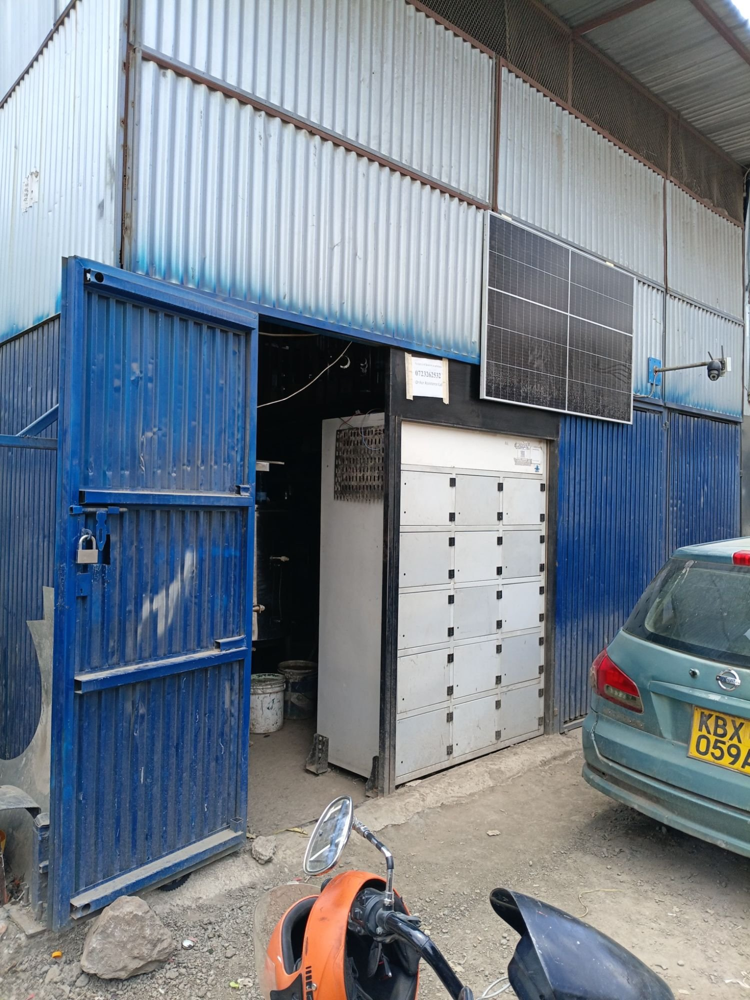
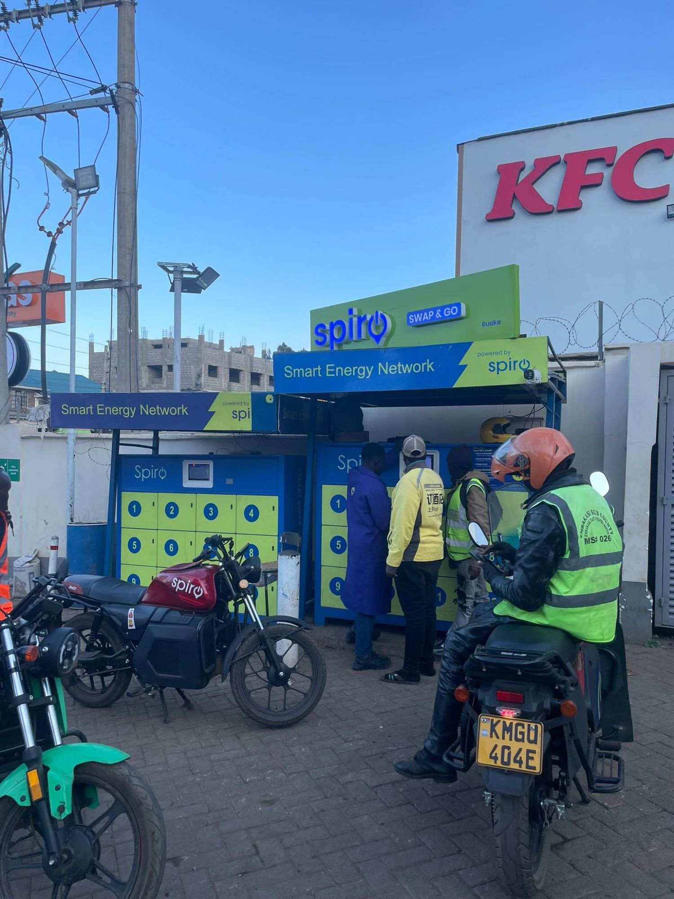

§ / Op-ed, Transport, Africa

# The Hidden Energy Economy: What Nairobi's Unofficial Battery Chargers Say About the Swap Network

*A hidden battery charger in Nairobi's Industrial Area shows how boda boda riders route around thin swap networks, and what operators and regulators can learn from it. The third essay from autumn 2026 fieldwork in Nairobi.*

1 November 2026 · 9 min read

<figure class="article-figure">
  
</figure>

## A rumour on Suguta Road

The first time I heard about the place was on the back of a motorcycle, on my way home from a day of interviews in Nairobi during my second round of fieldwork this autumn. The rider, who works on a Roam bike, pulled into one of the official charging points along Suguta Road to check on his battery, looked at the queue and the bikes lined up against the wall, and told me almost in passing that if you needed a battery quickly there was another place, somewhere in Industrial Area, that nobody talked about. He did not know exactly where it was, only that riders in a hurry went there and that it was faster than the hub.

For the next three days I asked everyone I could. I asked mechanics at the roadside spots where I had spent much of my fieldwork, I asked the attendants who run the official charging points, and I asked riders waiting at the hubs, and each of them either shrugged, said they had heard of such places without knowing one, or changed the subject with the kind of politeness that tells you the question has been understood perfectly well. In a city where a fundi can direct you to a specific clutch plate in a specific shop three streets away, the silence was itself a finding, because informal businesses in Nairobi are usually advertised loudly and this one was being protected.

The person who finally broke the silence was a rider I had interviewed five months earlier. He recognised my face at the Roam hub on Lusaka Road, remembered our conversation, and after hearing what I was looking for decided, after some hesitation, that he would take me there himself.

## Seven minutes into Industrial Area

The ride took about seven minutes from the Lusaka Road hub, off the tarmac and into the grid of gravel lanes behind the front-facing buildings of Industrial Area, where the city's workshops, fabricators and scrap dealers occupy the plots that the main roads hide. It was a dry day, so the lanes were dust and loose stone rather than mud, and a couple of dogs wandered between parked cars with the unhurried confidence of animals that live there. My rider stopped outside a high gate set into a fence behind one of the larger buildings, kept the engine running and made it clear that this was as far as he intended to go, and that he would rather I did not go further either.

I said I wanted to see it and talk to whoever ran it, and he shrugged and told me to go ahead. The gate opened as I approached it, for reasons I never established, and I walked straight in holding a sheet of paper and wearing the formal clothes I had put on for an interview that morning, which in hindsight made me look like a man on official business. Inside was a compound that felt less like a workshop than a small industrial theme park, with welders cutting steel under the open sky, stainless-steel tanks and frames stacked against the walls, a fabricator's banner advertising steel structures on the building next door, sacks of scrap waiting to be sorted and the smell of hot metal and dust over all of it.

In the middle of this, built into a corrugated-iron structure painted blue at the base and silver above, was the thing I had come for. A solar panel was bolted to the wall above the entrance, a CCTV camera watched the yard from a bracket beside it, and a handwritten sheet taped to the frame gave a phone number to call for assistance. Below them stood a tall white cabinet divided into fifteen locker compartments, each with its own small door, which looked so similar to the battery cabinets at official hubs that for a moment I wondered whether I had misunderstood the rumour. Parked outside was an electric boda boda with a green 100% Electric sticker on its tank and its battery bay open, waiting.

<figure class="article-figure">
  
</figure>

## The man who tried to do it officially

The owner, whom I will not name because the business he runs sits in a regulatory grey zone, came out to meet me with the guarded courtesy of someone who had not expected a visitor and was still deciding what kind of visitor I was. Once it was clear that I was a researcher rather than an inspector, he talked for longer than I had any right to expect, and what he described was not a scheme to cheat anyone but a business that had started out trying to be legitimate.

He told me he had first approached the charging business through the official route, hoping to become one of the partner sites that operators were recruiting as they expanded their networks. He had invested his own money in the cabinet, the wiring and the solar panel on the strength of that plan, and then the company's direction changed, with the network growing through its own hubs and larger stations rather than through small independent partners like him. He was left with equipment that had been bought for a purpose that no longer existed, a yard in a part of the city where hundreds of riders pass every day, and a clear view, from conversations with those riders, of how much of their working day disappeared at the official hubs.

So he built what he called his own thing. As he described it, riders who own their batteries, or who are caught short in the morning rush, bring them to him and leave them in a locker to charge while they wait or go off on a short trip, and they pay him a fee that he said is set to be fair to riders who are already paying a daily loan instalment on their bikes. Most of his customers come by word of mouth, which is how he wants it, and most of them return because the waiting time at his cabinet is shorter than at the hubs nearby. He spoke about the riders less as customers than as people he was helping to stay on the road, and he was visibly proud that a rider who might otherwise lose a morning could be back carrying passengers within a much shorter time.

He was also clear about the limits of what he was doing. He knew he did not hold a licence for a charging station, he knew the electricity he used was not being billed under the e-mobility tariff that licensed operators receive, and he knew that a business without papers in Industrial Area is a business that anyone with a badge, or a claim to one, can visit whenever they like. That is why the gate stays closed, why the riders who know about it do not tell researchers with notebooks, and why the rider who brought me had stopped outside.

## Two men in suits

I found out how real that last point was when I was leaving. As I walked back towards the gate, two men came in, both in formal clothes like mine, both with scars across their faces, walking with the unhurried purpose of people who knew exactly where they were going. My first thought was that they were electricians or inspectors from a utility, come to fix something or check a meter, and I was about to ask them about the installation when my rider appeared at the gate, caught my eye and told me in a low voice that it was time to go.

On the ride back he explained what he thought I had seen. Plain-clothes officers, he said, make regular rounds of unlicensed businesses in areas like this one, looking for a missing permit or an irregular connection, and the visit usually ends with a payment rather than a closure. I cannot know who those two men were or why they came, and I would not want to accuse anyone on the strength of a glance at a gate, but the rider's reading fitted everything the owner had told me about the costs of operating without papers. A business that cannot be seen by the regulator can still be seen by people who profit from its invisibility, and the cost of that attention is passed, eventually, to the riders who pay for each charge.

## What a workaround is telling us

It would be easy to read this site as a problem to be shut down, and some of the risks are real. Lithium-ion batteries charged on equipment without type approval, outside the battery management systems that operators use to monitor cell temperature and health, can fail in ways that are dangerous in a corrugated-iron shed next to a welding yard. Kenya's Electric Vehicle Charging and Battery Swapping Infrastructure Guidelines, in force since September 2023, require charging equipment to be certified or type-approved by KEBS and swapping batteries to be BMS-enabled for monitoring and safety, and both requirements exist for good reasons ([Oraro & Company Advocates, 2023](https://www.oraro.co.ke/wp-content/uploads/2023/10/The-Electric-Vehicle-Charging-and-Battery-Swapping-Infrastructure-Guidelines-2023.pdf); [Obura, 2023](https://kenyanwallstreet.com/epra-issues-guidelines-for-electric-vehicle-charging-battery-swapping-infrastructure/)).

The more useful reading, I think, is to treat the site as a measurement. In my earlier piece on this fieldwork I argued that the scarce resource for electric boda boda riders is [time at the hub](/insight-four-hours-at-the-hub), where a battery that is out of stock can turn a ten-second swap into an afternoon on a bench. A hidden cabinet in Industrial Area, protected by riders who will not even tell a familiar researcher where it is, is what that scarcity looks like when someone decides to sell a solution to it. Riders are paying a stranger behind a locked gate, at some risk to their batteries and their warranties, because the hour they save is worth more to them than the safety and convenience the official network promises but cannot always deliver during the morning rush. Simone (2004) described how residents of African cities become infrastructure for one another, assembling services from improvised connections where formal systems are thin, and Nairobi's electric transition is already producing its own version of that economy, nine months after the launch of a national policy designed to formalise it.

The contradictions are visible in the rules themselves. The 2023 guidelines require public charging and swapping stations to be accessible to all electric vehicles regardless of make or model ([Kenyans.co.ke, 2023](https://www.kenyans.co.ke/news/92984-epra-issues-new-directive-electric-vehicle-businesses)), yet in practice each operator runs its own batteries on its own cabinets, so a rider whose operator's hub is empty cannot walk across the road to a competitor. The National Electric Mobility Policy launched in February 2026 commits the government to compatible charging systems and standardised battery swapping nationwide ([Down To Earth, 2026](https://www.downtoearth.org.in/amp/story/africa/kenyas-new-e-mobility-policy-can-make-it-a-to-clean-industrial-hub)), but that commitment has not yet reached the bench at the hub. Licensing, meanwhile, is built for operators with legal teams, since each station in a chain requires its own retail supply licence ([CrossBoundary Energy, 2024](https://crossboundaryenergy.com/kenya-issues-solar-license-for-electric-two-wheelers/)), a threshold that a man with one cabinet and a solar panel is unlikely to cross. Even the welcome removal of the 15,000 kWh monthly ceiling on the e-mobility tariff in September 2026 ([Techweez, 2026](https://techweez.com/2026/09/22/ev-charging-electricity-tariff/)) helps the large networks whose consumption is growing fastest, while doing nothing for the small sites that sit outside the tariff altogether.

The scale of the formal networks makes the gap easier to see rather than harder. Spiro, whose Swap and Go stations now stand on forecourts across the city, reported more than 400 swap stations in Kenya by early 2026 ([Kuhudzai, 2026](https://cleantechnica.com/2026/02/24/spiro-raises-50-million-as-demand-for-its-battery-swapping-infrastructure-evs-surges-across-africa)), and an estimated 90% of the country's charging infrastructure is concentrated in Nairobi ([TheCityFix, 2026](https://thecityfix.com/?p=147438)). If riders in the best-served city in the country are still seeking out a locked yard in Industrial Area, the shortage is not about the number of stations on a map but about whether a charged battery is waiting at the right place at seven in the morning.

  <figure class="article-figure"></figure>
  <figure class="article-figure"></figure>

## From hidden cabinet to licensed agent

Kenya has solved a version of this problem before. M-Pesa did not reach every village by building company branches but by licensing tens of thousands of small shopkeepers as agents, each operating under the network's rules, systems and oversight while keeping their own premises and customers. Battery charging could follow a similar path, and the owner I met is in many ways exactly the agent that model would need, since he has the site, the equipment, the riders' trust and a demonstrated willingness to do it properly if a proper route were open to him.

Three changes would move sites like his from behind the gate into the network. The first is a light licence tier for small charging and swapping points, with simplified electrical inspection, a single registration covering an operator's partner sites and access to the e-mobility tariff, so that the cost of becoming legal is lower than the cost of paying for invisibility. The second is for operators to revive and expand their partner programmes, supplying certified cabinets that connect to their battery management systems, so that a battery charged in a yard in Industrial Area is monitored as closely as one charged at a hub, and so that the operator, rather than a stranger, carries the liability. The third is to make the official network report what riders already know, by publishing battery availability and waiting times by hub and by hour, which would show regulators and investors where the informal economy is filling gaps before it fills them with uninspected equipment.

None of this requires anyone to pretend that unlicensed charging is safe or that it should simply be tolerated. It requires taking seriously the information that a workaround carries, which is that riders have priced their time, found the official network wanting at the moments that matter most, and are willing to pay someone else to close the gap. The owner behind the gate saw that gap before most of the policy documents did, and the question for Kenya's e-mobility transition is whether people like him will be brought inside the network as agents or left outside it, paying for the privilege of being overlooked.

## References

- CrossBoundary Energy. (2024). [Kenya issues solar licence for electric two-wheelers](https://crossboundaryenergy.com/kenya-issues-solar-license-for-electric-two-wheelers/).
- Down To Earth. (2026). [Kenya's new e-mobility policy can make it a clean industrial hub](https://www.downtoearth.org.in/amp/story/africa/kenyas-new-e-mobility-policy-can-make-it-a-to-clean-industrial-hub). *Down To Earth*.
- Energy and Petroleum Regulatory Authority. (2023). [Electric Vehicle Charging and Battery Swapping Infrastructure Guidelines, 2023](https://epra.go.ke/sites/default/files/2025-03/E-Mobility%20Charging%20Infrastructure%20Guidelines.pdf). EPRA, Kenya.
- Kenyans.co.ke. (2023). [EPRA issues new directive to electric vehicle businesses](https://www.kenyans.co.ke/news/92984-epra-issues-new-directive-electric-vehicle-businesses).
- Kuhudzai, R. J. (2026, 24 February). [Spiro raises $50 million as demand for its battery swapping infrastructure and EVs surges across Africa](https://cleantechnica.com/2026/02/24/spiro-raises-50-million-as-demand-for-its-battery-swapping-infrastructure-evs-surges-across-africa). *CleanTechnica*.
- Ministry of Roads and Transport. (2026). [National Electric Mobility Policy](https://www.transport.go.ke/sites/default/files/Emobility%20Policy%20Final.pdf). Republic of Kenya.
- Obura, F. (2023, 15 September). [EPRA issues guidelines for electric vehicle charging, battery swapping infrastructure](https://kenyanwallstreet.com/epra-issues-guidelines-for-electric-vehicle-charging-battery-swapping-infrastructure/). *The Kenyan Wall Street*.
- Oraro & Company Advocates. (2023). [The Electric Vehicle Charging and Battery Swapping Infrastructure Guidelines 2023](https://www.oraro.co.ke/wp-content/uploads/2023/10/The-Electric-Vehicle-Charging-and-Battery-Swapping-Infrastructure-Guidelines-2023.pdf).
- Simone, A. (2004). People as infrastructure: intersecting fragments in Johannesburg. *Public Culture*, 16(3), 407–429. [doi:10.1215/08992363-16-3-407](https://doi.org/10.1215/08992363-16-3-407)
- Techweez. (2026, 22 September). [EPRA scraps EV charging electricity tariff cap](https://techweez.com/2026/09/22/ev-charging-electricity-tariff/).
- TheCityFix. (2026). [Kenya's e-mobility policy and the county readiness gap](https://thecityfix.com/?p=147438). World Resources Institute.
- Author's fieldwork and conversations with riders, mechanics, hub staff and the site owner, Nairobi, September–October 2026.

*The conversations described in this piece were not recorded. Accounts are paraphrased from notes written the same day, and names and the exact location of the site are withheld to protect the people involved.*

---

*This is the third op-ed in Marcel's autumn 2026 Nairobi fieldwork series. See [Four Hours at the Hub](/insight-four-hours-at-the-hub) on why time, not price, is the real constraint for electric boda boda riders, and [Hands Never Still](/insight-hands-never-still) on the jua kali fundis the electric transition is routing around. For the Lab's applied work, see [E-Mobility &amp; Transport](/expertise-e-mobility). To discuss a study, see [Contact](/contact).*
